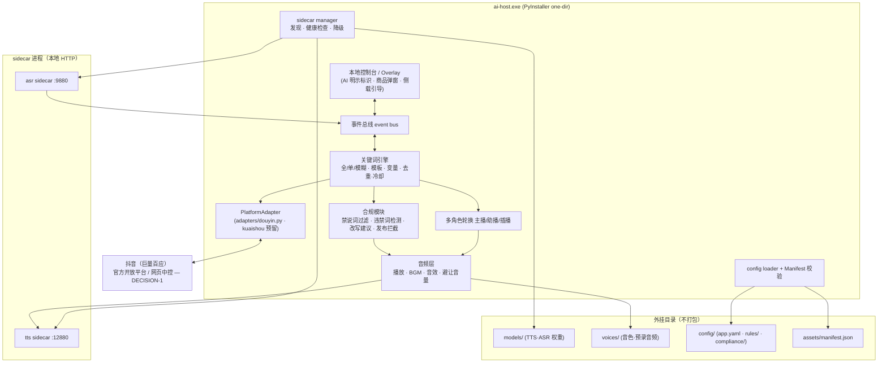

# 技术设计 — MARS-4 AI 直播助播 MVP（Python · 抖音优先）

| 字段 | 值 |
| --- | --- |
| **创建者** | Architect-9d1bd31f（Squad 成员） |
| **创建时间** | 2026-10-17 21:30（UTC+8） |
| **版本** | v0.1 |
| **状态** | 草稿 |
| **JIRA / Issue** | MARS-4 |
| **上游需求** | MARS-4 Issue 正文「范围基线」（本工作区未接入 Confluence，Issue 正文即上游 PRD；文中以「基线」指代） |
| **落地位置** | 本仓库 `docs/design/MARS-4/design.md` |

> 本文遵循 `multica-technical-design`。范围以 MARS-4 Issue 正文为基线：**范围内 9 项按原件语义 1:1 复刻；两项合规红线不进入设计**（见「非目标」）。

---

## 1. 理解（系统当前做什么）

### 1.1 现状

- 本仓库为**空基线**：`main` 仅有 `README.md` / `.gitignore` 与分支约定，**无产品代码**（`git log` 仅一条 bootstrap 提交）。
- 参照原件 `D:\BaiduNetdiskDownload\【8G版】闪电AI1.7.0\闪电AI`（电商无人直播 AI 主播工具，易语言/ExUI + 若干 DLL + 外挂 Python sidecar）。

### 1.2 原件的可核实结构（作为 1:1 复刻的目标语义）

| 原件位置 | 事实 | 对设计的含义 |
| --- | --- | --- |
| `APP.exe`（~172MB） | 单体主程序（易语言/ExUI） | 我们用 Python 单主程序等价替代 |
| `config/config.ini` | `[登录]` 卡密 + `[谷歌安装路径]chrome.exe` | 卡密属红线，不复刻；需要 Chrome 路径配置项 |
| `config/114BDCBA98A4.ini` | `编辑框_直播间链接DY/KS`、`编辑框_apikey3`+`改写要求`+`快速改写/深度改写`、`选择框_替换违禁词`、`随机音量*`/`随机变速*`/`避让音量*`、`更换主播模型1..4`(60/120s)、`更换txt间隔`/`更换目录间隔`、`过滤违禁词` | 配置字段即功能清单；含红线字段（替换违禁词），合规版不实现 |
| `配置文件/*.txt` | 规则全部为 `关键词组=回复` 文本行；`【a#b#c】` 随机取一；`{用户名称}{现在时间}{在线人数}{礼物名称}{再过10分钟}` 变量；`{音频=路径}` 播放预录 | 规则引擎的**权威输入样本**，见 §4.1 |
| `配置文件/全匹配关键词1.txt`、`单匹配关键词1.txt` | 内容相同，差别在**匹配模式**（全匹配=整串相等；单匹配=包含任一关键词） | 引擎需两种模式，同时加载 |
| `配置文件/关键词弹窗1.txt` | 三段式 `关键词=商品号=文案`（如 `女装 新款=3=新款女装在3号…`） | 商品弹窗规则 |
| `配置文件/回答主播1.txt` | 触发侧可为文本或 `{音频=路径}`（ASR 听主播语音/音频触发） | ASR → 规则联动 |
| `配置文件/AI自定义角色/{主播角色,助播角色,插播角色}` | 三角色目录 | 多角色切换 |
| `配置文件/屏蔽敏感词.txt` | `好物 微信 抖音 快手 绝对 第一 最好 唯一 秒杀 …` | 禁说词过滤（范围内第 9 项，1:1） |
| `配置文件/替换违禁词.txt` | `最=非常`、`第一=领先`… | **红线①：替换后照说** → 合规版不实现，改为「检测+改写建议+拦截」 |
| `tts/SET.bat` + `tts/models/`（`damo`/`openai`/`checkpoints`/`vocos`）+ `tts/app/toold_app.py`、`toolf_app.py` | TTS/ASR 为 **FastAPI/uvicorn 独立 sidecar**，默认端口 12880 / 9880，模型目录外挂、离线加载 | sidecar 方案与端口约定 |
| `lib/*.dll`（`bass.dll`/`bass_mix`/`bass_fx`/`bass_dsp`） | BGM/音效/混音/避让音量 | 音频播放与混音能力 |
| `locales/.../History`、`127.0.0.1:33711/autoec/…` | 平台接入 = **Chrome 中控（buyin.jinritemai.com）+ 本地注入页**，非官方开放平台 | 平台接入路线（见 §4.2 / DECISION-1） |

### 1.3 与基线范围的对齐

范围内 9 项业务规则（弹幕采集、关键词应答引擎、双通道应答、ASR、关注/点赞/礼物/欢迎新人、定时随机插话/报时/BGM/音效、商品弹窗、多角色、禁说词过滤）**全部保留并按原件语义实现**；范围外红线两项以合规实现替代（§4.6）。**不改需求**：产品范围、业务规则、字段口径仍归 Leader 收敛，设计只在实现层给出最小方案。

---

## 2. 非目标（明确不做，防范围蔓延）

| 编号 | 非目标 | 理由 |
| --- | --- | --- |
| NG-1 | **违禁词「替换后照说」**（同义替换后继续播报，规避广告法/平台审核） | 合规红线①：不实现。以 §4.6 的检测/改写建议/拦截替代 |
| NG-2 | **无人直播伪装真人**（「我们是真人」话术、规避真人核验） | 合规红线②：不实现。以 AI 明示替代 |
| NG-3 | 卡密授权 / 破解逻辑 | 受保护资产 |
| NG-4 | 原件皮肤、ExUI 私有控件等受保护资产 | 受保护资产 |
| NG-5 | 反检测 / 浏览器指纹伪装 / 规避风控 | 属规避行为，不做（直接决定 §4.2 中控路线风控判断） |
| NG-6 | 一期快手实测适配 | 原件仅抖音有运行证据；快手仅接口预留 |
| NG-7 | 主程序内嵌 torch / 模型权重 | 违反「模型外挂 sidecar」工程要求 |
| NG-8 | 产品需求/业务规则/字段口径的修改 | 归 Leader/PM，不由设计变更 |

---

## 3. 建议改动（最小可行方案）

### 3.1 总体形态

单主程序 `ai-host.exe`（Python 3.11+，PyInstaller **one-dir**）：**core 打进 exe 且可热替换**，`models/`、`voices/`、`config/` 外挂并按 Manifest 校验；TTS/ASR 为**独立本地 HTTP sidecar**，未安装时降级为「仅预录音频」；平台层经统一 `PlatformAdapter` 抽象，一期落地抖音。



### 3.2 目录结构（core 内嵌 / 外挂分离）

```text
shandian2/
├─ main.py                      # 唯一主程序入口（PyInstaller 入口）
├─ core/                        # → 打进 exe；支持 core_override/ 热替换（§3.3）
│  ├─ app.py                    # 装配与生命周期
│  ├─ config/{loader.py,manifest.py,schema.py}
│  ├─ engine/{keywords.py,template.py,dedup.py,compliance.py}
│  ├─ events/{bus.py,rules.py}
│  ├─ roles/rotation.py
│  ├─ audio/{player.py,mixer.py,synth.py}
│  ├─ asr/client.py
│  ├─ adapters/{base.py,douyin.py,kuaishou.py}
│  ├─ ui/{control.py,overlay.py,onboarding.py}
│  └─ sidecar/manager.py
├─ sidecars/                    # 独立进程，随包分发或按需侧载
│  ├─ tts/                      # FastAPI；models 外挂
│  └─ asr/                      # FastAPI；models 外挂
├─ models/                      # 外挂（大、不常变）：TTS/ASR 权重
├─ voices/                      # 外挂：音色 + 预录音频（对应原件 主播音频1/2 等）
├─ config/                      # 外挂：用户配置 + 规则
│  ├─ app.yaml
│  ├─ rules/{全匹配关键词,单匹配关键词,关键词弹窗,感谢关注,感谢点赞,感谢礼物,欢迎新人,随机插话报时,回答主播,随机变量话术}.txt
│  └─ compliance/{禁说词.txt,违禁词库.yaml}
├─ assets/manifest.json         # 外挂目录版本/校验清单
├─ packaging/ai-host.spec       # PyInstaller one-dir
└─ docs/design/MARS-4/design.md
```

**规则文件格式沿用原件语义**（零迁移成本）：`关键词组(空格分隔)=回复`；`〔模板〕` 内的 `【a#b#c】` 随机取一；`{变量}` 运行时求值；**不含 `=` 的行视为注释忽略**（原件 `全匹配关键词1.txt` 中存在 `关键词：发货时间、快递信息` 这类行，解析器必须容错，否则会丢规则）。

### 3.3 core 热更（最小实现）

- 打包时 core 内嵌于 exe（`_internal/core`）。
- 启动时若存在外挂目录 `core_override/`，且其 `manifest.json` 声明的版本 > 内嵌版本、sha256 校验通过、且 `config/app.yaml: core.allow_override=true`，则把该目录前置到 `sys.path` 后导入。
- 默认关闭；无签名时仅做 sha256 完整性校验，并写审计日志。**不做任意代码静默执行**。

### 3.4 规则引擎（范围内第 2 项，1:1）

`core/engine/keywords.py`

- 规则来源：`规则文件` → `list[Rule]`，`Rule(group: list[str], reply: str, mode: FULL|SINGLE|FUZZY)`。
- **匹配模式**：`FULL`＝弹幕文本整体等于 `group` 中任一关键词；`SINGLE`＝弹幕包含 `group` 中任一关键词（子串）；`FUZZY`＝相似度 ≥ 阈值（如 `difflib.SequenceMatcher` / 编辑距离，阈值入配置）。
- **优先级**：多规则命中取「匹配模式精确度 + 关键词长度」排序；同分取规则文件行序（确定性）。
- `core/engine/template.py`：`【a#b#c】` 递归随机取一（支持嵌套）；变量表 `{用户名称}{现在时间}{在线人数}{礼物名称}{再过10分钟}`（变量表以原件样本为准，完整枚举见 §4.1）。
- `core/engine/dedup.py`：同用户+同规则组的**冷却窗口**内抑制重复；同一条弹幕 `(user, text)` 去重。冷却/去重参数入 `app.yaml`（精确取值见 DECISION-2）。
- 双通道应答：回复求值后若为 `{音频=路径}` → 直接播放预录；否则交 TTS 合成播放（第 3 项）。混排规则（触发侧亦可是 `{音频=…}`，见 `回答主播1.txt`）按同一解析器处理。

### 3.5 事件规则（第 5、6 项）

`core/events/rules.py` 订阅事件总线：`follow`/`like`/`gift`/`enter`(欢迎新人)/`timer`(定时·随机插话)/`hourly`(整点报时)/`bgm`/`sfx`。文案取自同名规则文件，`{用户名称}{礼物名称}` 注入。BGM/音效/避让音量由 `core/audio/mixer.py` 处理（对应原件 `bass_*`）。

### 3.6 商品弹窗（第 7 项）

`关键词=商品号=文案` 三段式；命中 → `adapter.show_product(商品号, 文案)` + UI Overlay 呈现。

### 3.7 多角色（第 8 项）

`core/roles/rotation.py`：`主播/助播/插播` 各绑定音色（TTS voice）与规则/音频子集；支持定时轮换（对应 `更换主播模型1..4` 的 60/120s）。**合规约束**：轮换仅用于听感自然，不得用于规避平台指纹/身份识别。

### 3.8 ASR（第 4 项）

`asr/client.py` → ASR sidecar（FunASR / faster-whisper，外挂模型）。主程序不含 torch。链路：音频回采 → ASR → 文本 → 「回答主播」规则集。

### 3.9 平台适配器（工程要求）

```python
class PlatformAdapter(Protocol):
    def start(self, room_url: str) -> None: ...
    def stop(self) -> None: ...
    def fetch_events(self) -> Iterator[PlatformEvent]: ...  # 弹幕/进入/关注/点赞/礼物
    def send_message(self, text: str) -> SendResult: ...     # 文字发言
    def show_product(self, product_no: str, text: str) -> None: ...
    @property
    def connected(self) -> bool: ...
```

- `adapters/douyin.py`：一期实现，含**断线自动重连**（指数退避 + 心跳，`connected` 暴露给健康监控）。
- `adapters/kuaishou.py`：接口占位（`NotImplementedError` + 明确「未验证」标注），后续接入。
- 具体接入路线（官方/中控）见 §4.2 与 DECISION-1。

### 3.10 方案备选与取舍（工程形态）

| 决策点 | 备选 | 取舍 |
| --- | --- | --- |
| 打包形态 | one-file vs **one-dir** | 选 one-dir：启动快、`core/` 可热替换、符合基线 |
| sidecar 通信 | 进程内嵌 vs **本地 HTTP 独立进程** | 选独立进程：主程序不背 torch、可单独安装/降级 |
| 规则格式 | 新 JSON/YAML vs **沿用原件 txt 语义** | 沿用：零迁移、可直接用原件配置做基线 fixture |
| 平台抽象 | 直接写抖音 vs **PlatformAdapter + 适配器** | 选抽象：满足工程要求、为快手/视频号预留 |

---

## 4. 关键设计明细

### 4.1 规则/变量基线（源自原件 `配置文件` 样本）

| 规则文件 | 语义 | 关键样本 |
| --- | --- | --- |
| 全匹配关键词 | 整串相等 | `无人 录播 录像=…我们都是真实的…`（注：此条**触碰红线②话术**，落地时按 §4.6 改为 AI 明示，见 DECISION-5） |
| 单匹配关键词 | 包含任一 | `加急 拍了 已拍=好的,【{用户名称}#姐妹】…` |
| 关键词弹窗 | `关键词=商品号=文案` | `女装 新款=3=新款女装在3号…` |
| 感谢关注/点赞/礼物 | `{用户名称}{礼物名称}` | `感谢{用户名称}老板送的{礼物名称}` |
| 欢迎新人 | `{用户名称}` | `欢迎{用户名称}【老板 大哥 姐姐 宝宝】的到来…` |
| 随机插话报时 | `{现在时间}{在线人数}{再过10分钟}` | `【姐妹们1号链接库存不多咯…】…再过10分钟{再过10分钟}我们就要下播了` |
| 回答主播 | 主播语音→应答（触发侧可为音频） | `{音频=配置文件\主播音频1\01主播音频\音频001.mp3}={音频=配置文件\其他音频\安排上车.mp3}` |

> **变量完整枚举**：`{用户名称}`、`{现在时间}`、`{在线人数}`、`{礼物名称}`、`{再过10分钟}`（原件样本可见）。解析器对未知 `{变量}` 应保留原文并告警，不静默清空。

### 4.2 OP-抖音接入路线（DECISION-1：供人类决策）

两条路线，**均不改业务语义**，只改平台交互底座。

#### 方案 A — 官方开放平台（抖音开放平台 / 巨量百应 OpenAPI）

| 维度 | 评估 |
| --- | --- |
| 能力覆盖 | 直播间互动（小玩法/弹幕/点赞/礼物）需**开发者入驻 + 类目资质/审核**；电商商品走百应；**第三方「主动发弹幕」与「商品弹窗」官方基本不开放** |
| 合规 | 高：官方授权、有 SLA |
| 稳定性 | 高：接口化，不受页面改版影响 |
| 门槛 | 高：企业/ISV 资质、审核周期、类目限制；一期可能无法在排期内落地 |
| 风控 | 低（授权使用） |

#### 方案 B — 网页中控兜底（Chrome 自动化 + 本地注入页，复刻原件）

| 维度 | 评估 |
| --- | --- |
| 能力覆盖 | 完整：采弹幕 / 发消息 / 商品弹窗均可做 |
| 合规 | 中低：无授权；且 **NG-5 禁止反检测/指纹伪装**，故本路线在合规版下**无任何风控规避手段** |
| 稳定性 | 低：依赖 DOM 结构，页面改版即失效；需持续维护 |
| 门槛 | 低：零资质，即刻可跑 |
| 风控 | **高**：自动化特征显著，账号可能被限流/封禁；不可作为默认生产路线 |

#### 推荐 — 方案 C（分层混合，可回退）

- **采集层**：优先官方；官方资质未就绪期间，中控**只读采集**作为过渡（不注入反检测脚本、不做指纹伪装）。
- **发送层**：优先官方文本能力；中控发送作为**受控降级**（默认关闭，需显式开关 + 限频 + 审计日志 + 一键停）。
- **AI 明示**：无论哪条路线，合成语音/数字人均带明示标识（§4.6）。
- **决策权**：人类负责人决定①是否具备官方资质、②是否接受中控风控。Adapter 抽象保证两条路线**可切换、不返工**。

> 该决策影响 `adapters/douyin.py` 的实现深度，**不阻塞**其余 core（规则引擎/合规/音频/sidecar）开发。建议：先按方案 C 的采集只读 + 本地播报落地，把「自动发送/商品弹窗」标为受控降级默认关闭。

### 4.3 数据与状态

| 实体/状态 | 说明 | 一致性要求 |
| --- | --- | --- |
| 配置 | `config/app.yaml`（sidecar 端口、匹配阈值、冷却/去重、开关） | 启动加载，非法即拒绝启动并提示 |
| 规则 | `config/rules/*.txt`（原件语义） | 热加载可选；非法行跳过 + 告警 |
| 禁说词 / 违禁词库 | `config/compliance/*` | 版本化，随规则热更新 |
| Manifest | `assets/manifest.json`：外挂目录版本 + 文件 sha256 | 启动校验；缺失/不匹配 → 引导侧载 + 降级 |
| 运行时 | 连接状态、去重表、冷却表、事件队列 | 进程内；可选 SQLite 审计（发送记录、合规拦截记录） |

无既有数据库；原件亦无持久库。审计日志为**新增可选项**（合规需要留痕，建议一期即做）。

### 4.4 接口与契约边界

| 边界 | 契约 |
| --- | --- |
| core ↔ TTS sidecar | `GET /health`；`POST /tts {text, voice, speed}` → 音频（文件/字节流）。默认端口 `12880`（沿用原件） |
| core ↔ ASR sidecar | `GET /health`；`POST /asr (audio)` → `{text}`。默认端口 `9880`（沿用原件） |
| core ↔ 平台 | 仅经 `PlatformAdapter`，UI 只读订阅，不得绕过 |
| UI ↔ core | 本地控制台（规则编辑/角色/状态/合规告警）、Overlay（商品弹窗、AI 明示、侧载引导） |
| 错误约定 | sidecar 不可用 → 发 `SidecarUnavailable` 事件 → 应答降级为预录音频；平台断连 → 重连 + 状态可见 |

### 4.5 非功能需求

- **性能**：单房间弹幕量级（数十条/秒）内，规则匹配 O(规则数) 且命中即返回；sidecar 调用异步不阻塞事件循环。
- **可用性**：任一 sidecar / 平台不可用均**降级不崩溃**（未装模型可启动，仅预录音频）。
- **安全**：不落盘卡密；LLM/平台凭证经配置读取，日志脱敏；`core_override` 需显式开关 + sha256。
- **可测试性**：规则引擎/合规模块为纯函数，可用原件 `配置文件` 样本做 fixture 单测。
- **可观测性**：结构化日志 + 审计（发送/拦截/重连/降级）。
- **合规**：合成语音明示；发布前拦截；不实现规避手段。

### 4.6 合规实现（红线替代）

| 红线 | 合规替代 | 落点 |
| --- | --- | --- |
| ① 违禁词「替换后照说」 | **开播前合规检测 + 改写建议 + 发布拦截**：命中违禁词库（广告法绝对化用语 `最/第一/唯一/绝对/顶级/国家级…`）→ **拦截输出** + 给出「不含违规主张」的改写建议。判定标准：改写结果可直接过审，**不是**同义替换后照念 | `core/engine/compliance.py` + `config/compliance/违禁词库.yaml` |
| ② 无人直播伪装真人 | **明示 AI**：合成语音/数字人带 AI 合成标识；不使用「我们是真人」类话术；允许无人值守自动播控，但须明示 | UI Overlay + 文案模板层 |
| 范围内第 9 项 | 禁说词命中**即不输出**（原件行为，1:1 保留） | `compliance.py` 前置过滤 |

### 4.7 迁移与回滚

- 无历史数据迁移（全新项目）。规则/配置沿用原件文本格式以降低迁移成本。
- 功能开关：`platform.send_enabled`（中控自动发送降级默认关）、`core.allow_override`（热更默认关）、`tts.enabled`（缺模型自动关）。
- 回滚：core 热更失败 → 回退内嵌 core；平台路线切换 → 换 Adapter 实现，无需改业务层。

---

## 5. 实现步骤（可执行）

**@BackendDev（主程序 core）**

1. 脚手架：`main.py` + `core/app.py` 装配；配置与 `assets/manifest.json` 加载 + 校验（缺失→引导+降级）。
2. 规则解析器：`rules/*.txt` → `Rule`，含 `关键词组=回复` 拆分、`〔【a#b#c】〕` 模板、`{变量}`、**无 `=` 行容错**；以原件 `配置文件` 样本为 fixture 单测。
3. 关键词引擎：`FULL/SINGLE/FUZZY` + 优先级 + 去重 + 冷却；单测覆盖基线用例（§4.1）。
4. 合规模块：禁说词前置过滤（第 9 项）+ 违禁词库检测 + 改写建议 + 发布拦截；单测覆盖「最/第一/唯一/绝对」。
5. 事件总线 + 事件规则：感谢关注/点赞/礼物、欢迎新人、定时·随机插话、整点报时、BGM、随机音效。
6. 音频层：预录音频播放、`{音频=路径}` 分支、BGM/音效/避让音量。
7. TTS/ASR sidecar：客户端 + `sidecar/manager.py`（发现/健康检查/启动/超时降级）。
8. 平台层：`PlatformAdapter` 抽象 + `adapters/douyin.py`（依据 DECISION-1；含断线重连）。
9. 多角色轮换：三角色绑定音色/规则/音频 + 定时轮换。
10. 审计日志：发送/拦截/重连/降级事件落盘。

**@FrontendDev（UI/交互）**

1. 本地控制台：规则编辑、角色配置、运行状态、合规告警列表。
2. **AI 明示标识**（界面 + 文案）与商品弹窗 Overlay。
3. 侧载引导页（`models/`/`voices/` 缺失时引导安装并展示 Manifest 期望版本）。
4. 打包产物冒烟（one-dir 双击运行）。

**@DevOps**

1. `packaging/ai-host.spec`（PyInstaller one-dir，core 内嵌、外挂目录排除）。
2. Manifest 生成脚本 + 目录分离校验。
3. 部署分支合入流程（`feat/ai-host-mvp` → `release/MARS-4-ai-host-mvp`）。

**@Tester**：按 §6 验证计划逐条执行，重点覆盖基线用例表与降级路径。

---

## 6. 验证计划

| 验证项 | 方式 | 对应 AC |
| --- | --- | --- |
| 抖音直播间稳定采弹幕、断线自动重连 | 接入真实/沙箱房间，人工断网注入后观察重连与恢复 | AC-1 |
| 关键词/变量/随机/冷却与基线逐条一致 | 以 §4.1 样本为 fixture 跑规则单测 + 端到端用例表 | AC-2 |
| 未装模型可启动且仅用预录音频；装模型后 TTS 可用 | 两种环境各启动一次，观察降级事件与 TTS 输出 | AC-3 |
| `dist/ai-host.exe` 双击运行、模型目录可独立替换 | 替换 `models/` 内容后重启，校验 Manifest | AC-4 |
| 合规检测拦下「最/第一/唯一/绝对」并给改写建议 | 注入含违规词文案，断言拦截 + 建议非「同义替换」 | AC-5 |
| 所有 AI 合成语音在界面/文案有明示 | UI 走查 + 文案模板断言 | AC-6 |

---

## 7. 需求追溯

| 需求 | 设计决策 | 实现步骤 |
| --- | --- | --- |
| AC-1 弹幕采集+重连 | §3.9 PlatformAdapter + 重连 | B8 |
| AC-2 关键词/变量/随机/冷却 | §3.4 引擎 + §4.1 基线 | B2, B3 |
| AC-3 未装模型降级 / 装后 TTS | §3.10 sidecar + §4.4 错误约定 | B7 |
| AC-4 exe 双击 + 模型可替换 | §3.2 目录分离 + §4.3 Manifest | B1, D1, D2 |
| AC-5 合规拦截 + 改写建议 | §4.6 红线① | B4 |
| AC-6 AI 明示 | §4.6 红线② | B4, F2 |
| BR 范围内 1–9（业务规则） | §3.4–3.8（1:1） | B2–B9 |
| 工程：单主程序/core 热更/外挂/sidecar/抽象 | §3.1–3.3, §3.9, §3.10 | B1, B7, B8, D1–D3 |

---

## 8. 风险与边界

| ID | 风险 | 缓解 |
| --- | --- | --- |
| RISK-1 | 中控 DOM 依赖脆弱、页面改版失效；无风控规避手段（NG-5） | 优先官方（方案 C）；中控作受控降级默认关；限频 + 审计 + 一键停 |
| RISK-2 | 自动发送/商品弹窗触发平台风控/封号 | 默认关闭自动发送；明示 AI；人工确认开关 |
| RISK-3 | 规则文件历史脏数据（无 `=` 行、混排）导致丢规则 | 解析器容错 + 跳过告警（§3.2） |
| RISK-4 | 冷却/去重精确取值未定义，1:1 无法判定 | DECISION-2：以基线用例表为准，先给默认值 |
| RISK-5 | 变量枚举不完备 | 未知变量保留原文 + 告警；DECISION-4 确认 |
| RISK-6 | core 热更引入任意代码执行 | 默认关；显式开关 + sha256 + 审计 |
| RISK-7 | sidecar 缺失/崩溃影响可用性 | 健康检查 + 降级为预录音频，不崩溃 |
| RISK-8 | 打包后外挂目录路径解析错误 | one-dir 固定相对布局 + Manifest 校验 + 冒烟用例 |
| RISK-9 | 红线话术样本（`全匹配关键词1.txt` 含「我们是真人啊」）被原样带入 | DECISION-5：落地模板按 §4.6 改写为 AI 明示，红线话术不得进产物 |

---

## 9. 待决事项

| ID | 事项 | 影响 / 建议 | 需谁决策 |
| --- | --- | --- | --- |
| **DECISION-1** | **OP-抖音接入路线**：官方开放平台 vs 网页中控兜底（§4.2） | 建议方案 C（分层混合，可回退）；决策前不阻塞其余 core | 人类负责人 hntangkai |
| DECISION-2 | 冷却/去重精确参数与**「基线用例表」**（AC-2 判定依据） | Issue 提到「基线用例表逐条一致」，但未见该表；建议提供或由 §4.1 样本 + 默认值收敛 | Leader / 负责人 |
| DECISION-3 | 模糊匹配算法与阈值 | 建议 `difflib`/编辑距离 + 可配置阈值，出厂给保守默认 | Leader |
| DECISION-4 | 变量完整枚举（`{再过10分钟}` 等） | 建议以原件样本为准并允许扩展；未知变量保留原文 | Leader |
| DECISION-5 | 红线话术样本（如 `我们是真人啊`）的合规改写口径 | 必须按 §4.6 改写为 AI 明示；不得原样复刻 | Leader |
| DECISION-6 | 合规改写建议是否引入 LLM（原件用 `编辑框_apikey3` 调大模型） | 建议「规则库 + 可选 LLM 建议」，LLM 仅出建议、不自动播报 | Leader |

> 阻塞项：无。上述为**可并行推进的待确认项**；DECISION-1 影响 `adapters/douyin.py` 深度，其余设计不依赖它。

---

## 10. 修订记录

| 日期 | 版本 | 作者 | 变更摘要 |
| --- | --- | --- | --- |
| 2026-10-17 | v0.1 | Architect-9d1bd31f | 首稿：范围理解、非目标（红线两项）、工程形态、规则/适配器/合规设计、OP 路线对比与风控、验证计划、追溯、风险与待决 |
